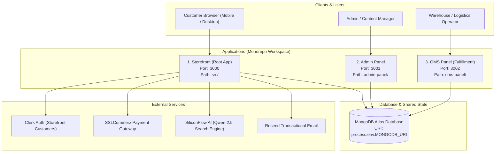

# ValleyCentia: System Architecture & Technical Context

> **Target Audience**: AI Agents and Engineers onboarding to this codebase.  
> **Repository Root**: `F:\valleycentia1`  
> **Primary Stack**: Next.js 16 (App Router + Turbopack), React 19, TypeScript 5, Tailwind CSS 4, MongoDB (Mongoose 8).

---

## 1. High-Level Architecture Topology

This codebase operates as a **coordinated multi-app workspace** where three separate Next.js applications share a single MongoDB Atlas database cluster, matching data models, and business constants.



### The Three Applications at a Glance

| Application | Path | Port | Auth Provider | Primary Responsibility |
| :--- | :--- | :--- | :--- | :--- |
| **Storefront** | `src/` (root) | `3000` | Clerk (`@clerk/nextjs`) | Customer browsing, AI search, cart, checkout (COD/SSLCommerz), review lightbox gallery, customer profile. |
| **Admin Panel** | `admin-panel/` | `3001` | NextAuth (JWT / Credentials) | Catalog management (products, sizes, stock, brands), homepage CMS (hero slides, sections), coupons, site settings. |
| **OMS Panel** | `oms-panel/` | `3002` | NextAuth (JWT / Credentials) | Order lifecycle management, status state machine, printable invoice generation, parcel packing, courier tracking, analytics. |

---

## 2. Shared Database Layer & Singleton Pattern

All three applications connect to the same MongoDB database using **Mongoose 8** with a singleton connection cache to prevent connection leakages during Next.js Hot Module Reloading (HMR).

- **Storefront Singleton**: `src/lib/mongodb.ts`
- **Admin Panel Singleton**: `admin-panel/src/lib/mongodb.ts`
- **OMS Panel Singleton**: `oms-panel/src/lib/mongodb.ts`

```ts
// src/lib/mongodb.ts
// Uses global._mongooseCache to maintain a stable maxPoolSize: 10 connection
export async function connectToDatabase(): Promise<typeof mongoose>;
```

### Core Collections & Models

| Model | Schema File | Key Fields / Responsibilities |
| :--- | :--- | :--- |
| **`Product`** | `src/lib/models/Product.ts` | `name`, `slug`, `brand`, `category`, `sizes` (array with `size`, `price`, `stock`, `isDefault`), `images`, `rating`, `reviewCount`, `isActive`. |
| **`Order`** | `src/lib/models/Order.ts` | `orderNumber`, `customer` (id, name, email, phone), `items`, `shippingAddress`, `paymentMethod` (COD / sslcommerz), `orderStatus`, `paymentStatus`, `total`. |
| **`Review`** | `src/lib/models/Review.ts` | `productId`, `userId`, `userName`, `userEmail`, `rating`, `comment`, `images` (array of image URLs), `isDeleted`, `deletedAt`, `deletedBy`, `reports` (array of customer moderation flags). |
| **`Brand`** | `src/lib/models/Brand.ts` | `name`, `slug`, `logoUrl`, `tagline`, `image`, `description`, `sortOrder`, `isActive`. |
| **`Category`** | `src/lib/models/Category.ts` | `name`, `slug`, `image`, `parent`, `sortOrder`, `isActive`. |
| **`Coupon`** | `src/lib/models/Coupon.ts` | `code`, `discountType` (`percent` / `flat`), `discountValue`, `minOrderAmount`, `maxDiscount`, `expiresAt`, `isActive`. |
| **`SiteSetting`** | `src/lib/models/SiteSetting.ts` | Shipping fees, free shipping threshold, banner announcements, maintenance mode. |

---

## 3. Storefront Deep Dive (`src/`)

### 3.1 App Router Structure

```text
src/app/
├── (pages)
│   ├── page.tsx                     # Homepage (Hero, Brands, Categories, Ads, Products)
│   ├── shop/page.tsx                # Catalog listing with faceted search & brand/category filters
│   ├── product/[slug]/page.tsx      # PDP (Gallery, Variants, StickyActionBar, Reviews)
│   ├── cart/page.tsx                # Client-side shopping cart with coupon application
│   ├── checkout/                    # Multi-step checkout (Address, COD, Online Payment)
│   ├── auth/                        # Customer authentication (Clerk integration)
│   ├── signin/ & signup/            # Dedicated sign-in / sign-up routing with callback preservation
│   └── profile/                     # Order history & saved customer shipping addresses
├── api/
│   ├── ai-search/route.ts           # Natural language query expansion (SiliconFlow / Qwen)
│   ├── cart/route.ts                # Server-validated cart pricing & stock check
│   ├── reviews/[id]/route.ts        # Author & Admin review deletion with soft delete
│   ├── reviews/[id]/report/route.ts # Customer review reporting & moderation queue
│   ├── upload/route.ts              # Multipart file upload to public/uploads/ (JPG, PNG, WebP)
│   └── payment/                     # SSLCommerz init, success, fail, cancel, COD handlers
```

### 3.2 Key Frontend Components & Features

1. **"Brands That Lead" Carousel** (`src/components/BrandsThatLead.tsx`):
   - **Desktop View (`≥ 769px`)**: 4-column cards with lifestyle photography, brand name, tagline, and "Products ↗" link.
   - **Mobile View (`< 768px`)**: 2-row horizontal grid with `grid-auto-flow: column`. Displays landscape logo cards (`width: calc((100vw - 48px) / 2.5)`), showing exactly 2 full columns with the 3rd column peeking at the right edge (~2.5 columns visible).
   - **Auto-Scroll Drift**: Runs at a constant 24px/sec visual speed using `requestAnimationFrame`. Seamless 3-buffer group wrap. Pauses immediately on touch, resumes 2s after release.
   - **Tap vs. Drag Discrimination**: 6px distance threshold prevents accidental link navigation during horizontal scrolling.
   - **Fallback**: Gracefully falls back to bold text if logo URL is missing or broken (e.g. `/no-image.svg`).

2. **Mobile Sticky Action Bar** (`src/components/product/StickyActionBar.tsx`):
   - Renders a fixed bottom action bar on mobile viewports for Product Detail Pages.
   - Intersects with original Add-to-Cart buttons with an early trigger offset (280px) to ensure seamless CTA access as users scroll through description and reviews.

3. **Review Image Lightbox Gallery** (`src/components/product/ReviewImageGalleryModal.tsx`):
   - Full-screen accessible modal (`role="dialog"`, `aria-modal="true"`) for multi-image customer reviews.
   - Horizontal swipe gesture with finger tracking and threshold snap.
   - Keyboard arrows (`ArrowLeft`, `ArrowRight`, `Escape`) with focus trap.
   - Active thumbnail strip, image counter (e.g. `2 / 5`), and non-distorting `object-fit: contain` rendering.

4. **Review Security & Permissions System** (`src/lib/reviewAuth.ts`, `src/lib/csrf.ts`):
   - **Server-Side Authorization**: User identity derived from server session token, never client payload alone.
   - **Permissions**: Author can delete own review; store admins can delete any review; non-authors receive `403 Forbidden`.
   - **Soft Deletion & Recalculation**: Sets `isDeleted: true`, records `deletedAt` and `deletedBy`, and excludes soft-deleted reviews from product rating and count recalculation.
   - **CSRF & Rate Limiting**: Validates Origin/Referer against `NEXT_PUBLIC_BASE_URL` and rate-limits review submissions.

5. **AI Search Query Expansion** (`src/app/api/ai-search/route.ts`):
   - Uses SiliconFlow Qwen-2.5-7B Instruct API to expand customer search intent (e.g., "dry hair" $\to$ hair masks, conditioners, argan oil).
   - In-memory LRU cache (TTL 5 minutes).
   - Fallback dictionary for common cosmetic concerns and category keywords when API keys are absent.

---

## 4. Admin Panel Deep Dive (`admin-panel/`)

The Admin Panel is a dedicated Next.js application tailored for catalog and content operations:

- **Authentication**: NextAuth with credentials provider validating against the `User` collection.
- **Role Verification**: Only accounts with `role: "admin"` or `role: "superadmin"`, or matching allowlisted `ADMIN_EMAILS` or `ADMIN_USER_IDS`, can access `/admin/*` routes.
- **Product Management** (`admin-panel/src/app/admin/products`):
  - Multi-size variant matrix (size name, SKU, price, stock, default selector).
  - Image uploader, brand dropdown, category tagger, discount percentage.
- **CMS Management**:
  - `admin-panel/src/app/admin/hero-slides`: Reorder and edit carousel banners.
  - `admin-panel/src/app/admin/brands`: Brand logos, banners, taglines.
  - `admin-panel/src/app/admin/coupons`: Flat vs. percent discount codes with expiration and minimum spends.
  - `admin-panel/src/app/admin/visible-changes`: Before/after clinical proof showcases.

---

## 5. OMS Panel Deep Dive (`oms-panel/`)

The Order Management System handles warehouse operations, courier dispatches, and financial tracking:

- **Order State Machine** (`src/lib/constants/orderTransitions.ts`):
  ```mermaid
  stateDiagram-v2
      [*] --> pending
      pending --> confirmed
      pending --> cancelled
      confirmed --> packaging
      confirmed --> cancelled
      packaging --> handed_over_to_courier
      packaging --> cancelled
      handed_over_to_courier --> in_transit
      in_transit --> delivered
      in_transit --> returned
      in_transit --> failed_delivery
      failed_delivery --> returned
      delivered --> [*]
      cancelled --> [*]
      returned --> [*]
  ```
- **Invoice Generation**: Renders clean, print-ready invoices matching `@media print` rules, with one-click PDF generation via `html2canvas` and `jspdf`.
- **Stock Reconciliation**: Automatically reserves inventory upon order placement, releases reserved stock upon cancellation, and decrements final inventory upon courier handover.

---

## 6. Environment Variables Reference

| Variable Name | Required? | Purpose |
| :--- | :---: | :--- |
| `MONGODB_URI` | **Yes** | MongoDB connection string (shared across Storefront, Admin, OMS). |
| `NEXT_PUBLIC_CLERK_PUBLISHABLE_KEY` | **Yes** (Storefront) | Customer authentication public key. |
| `CLERK_SECRET_KEY` | **Yes** (Storefront) | Customer authentication secret key. |
| `NEXTAUTH_SECRET` | **Yes** (Admin/OMS) | Secret used to sign NextAuth session JWTs. |
| `NEXT_PUBLIC_BASE_URL` | **Yes** | Base domain (e.g. `https://valleycentia.com` or `http://localhost:3000`). |
| `ADMIN_EMAILS` | Optional | Comma-separated admin email allowlist. |
| `ADMIN_USER_IDS` | Optional | Comma-separated admin Clerk ID allowlist. |
| `SSLCOMMERZ_STORE_ID` | Optional | Payment gateway store ID. |
| `SSLCOMMERZ_STORE_PASSWORD` | Optional | Payment gateway secret. |
| `SSLCOMMERZ_IS_SANDBOX` | Optional | Set to `"true"` for test mode. |
| `RESEND_API_KEY` | Optional | Transactional order confirmation emails via Resend. |
| `AI_API_KEY` | Optional | SiliconFlow / Qwen API key for AI search expansion. |
| `AI_API_BASE_URL` | Optional | Custom base URL for AI search (default: `https://api.siliconflow.cn/v1`). |
| `AI_MODEL_NAME` | Optional | Model identifier (default: `Qwen/Qwen2.5-7B-Instruct`). |

---

## 7. Testing, Verification & Scripts

### Available Commands (from Repository Root)

```bash
# 1. Run all unit & integration tests (124 tests in tests/)
npm test

# 2. Run TypeScript typecheck across storefront
npx tsc --noEmit

# 3. Build storefront for production
npm run build

# 4. Lint storefront source code
npm run lint

# 5. Run storefront development server (port 3000)
npm run dev

# 6. Run Admin Panel (from admin-panel directory)
cd admin-panel && npm run dev    # Starts on port 3001

# 7. Run OMS Panel (from oms-panel directory)
cd oms-panel && npm run dev      # Starts on port 3002
```

### Test Suite Map (`tests/`)

- `tests/brandsThatLead.test.ts`: 2-row carousel geometry, 2.5 visible columns, 24px/s drift speed, tap-vs-drag threshold, loop wrapping.
- `tests/reviewPermissions.test.ts`: Author delete (200), non-author delete (403), admin delete (200), logged-out (401), report queue.
- `tests/reviewImageGallery.test.ts`: Lightbox touch swipe tracking, keyboard events, focus trapping.
- `tests/stickyActionBar.test.ts`: Scroll intersection trigger offset (280px) and viewport filtering.
- `tests/authRedirect.test.ts`: Post-auth redirect safety against open redirect exploits (`//evil.com`, `/\evil.com`).
- `tests/adminRbac.test.ts`: Admin and superadmin permission enforcement.
- `tests/orderStateMachine.test.ts`: Valid status transitions from `pending` to `delivered` / `cancelled`.
- `tests/sanitize.test.ts`: NoSQL injection (`$ne`, `$where`, prototype pollution) defense.

---

## 8. Critical Guidelines & Gotchas for Future Agents

1. **Do not mix package boundaries**:
   - `src/` (root) has its own `package.json` for the storefront.
   - `admin-panel/` and `oms-panel/` have their own independent `package.json` and `node_modules`. Do not install root dependencies into panels or vice-versa.
2. **Preserve Mongoose Singleton**:
   - Always call `await connectToDatabase()` from `@/lib/mongodb` before invoking any model queries in API routes or Server Components.
3. **Keep Mobile Breakpoint Uniform**:
   - The project uses `@media (max-width: 768px)` as the primary mobile breakpoint. Desktop/tablet layout (`≥ 769px`) must remain completely untouched when modifying mobile UI.
4. **Always verify tests & build before committing**:
   - Run `npm test` and `npx tsc --noEmit`. All 124 tests must pass with 0 TypeScript errors.

